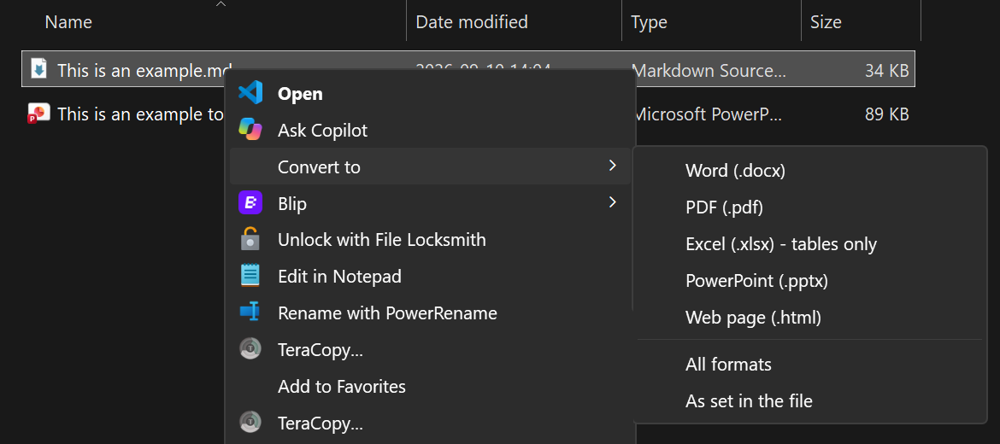
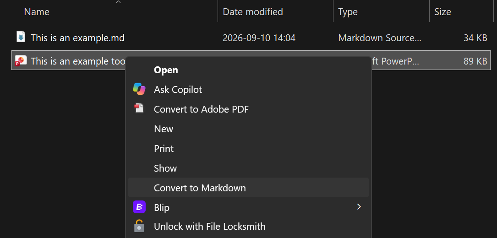
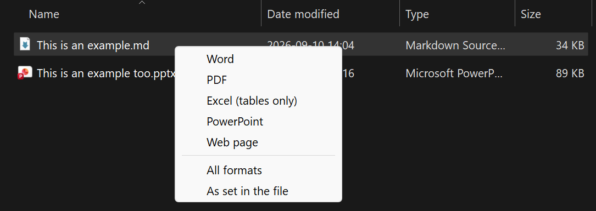
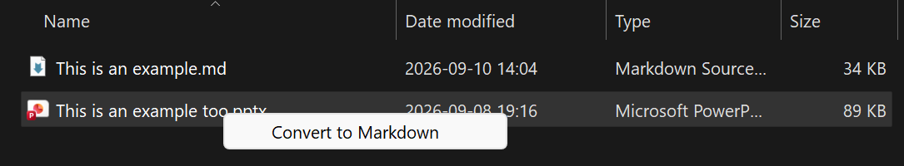

# convert-md

Right-click conversion between Markdown and Word, PDF, Excel, PowerPoint and HTML on Windows,
built on [Pandoc](https://pandoc.org) and Microsoft [MarkItDown](https://github.com/microsoft/markitdown).

[](https://github.com/W3i-io/convert-md/actions/workflows/tests.yml)
[](https://github.com/W3i-io/convert-md/blob/main/LICENSE)

## What it does

| Right-click on | Menu | Produces |
|---|---|---|
| `.md`, `.markdown` | **Convert to → Word** | `.docx` |
| | **Convert to → PDF** | `.pdf` (through Microsoft Word, or a Pandoc PDF engine) |
| | **Convert to → Excel** | `.xlsx`, one sheet per table |
| | **Convert to → PowerPoint** | `.pptx`, one slide per heading |
| | **Convert to → Web page** | self-contained `.html` |
| | **Convert to → All formats** | all of the above |
| | **Convert to → As set in the file** | the formats the file asks for (see below) |
| `.docx .pdf .xlsx .xls .pptx .html .htm .csv .epub .msg` | **Convert to Markdown** | `.md` |





- Output is saved next to the original. Nothing is overwritten: a repeat run writes `Report (1).docx`.
- A small popup confirms what was created and lists any problems.
- Optional **Ctrl+Alt+M** hotkey: select files in File Explorer and press it to get the same menu at the
  mouse pointer. Mixed selections work: Markdown files go out, everything else comes in.

| Ctrl+Alt+M on a Markdown file | Ctrl+Alt+M on any other file |
|---|---|
|  |  |

## Install

Needs Windows 10 or 11 and Python 3.11 or newer from python.org
(`winget install --id Python.Python.3.12 -e --scope user`).

1. Download the latest release from the [Releases page](https://github.com/W3i-io/convert-md/releases)
   (**Source code (zip)**) and extract it, or `git clone https://github.com/W3i-io/convert-md`.
2. In PowerShell, in that folder:

   ```powershell
   powershell -ExecutionPolicy Bypass -File .\install.ps1
   ```

The installer sets everything up for your Windows account only (no administrator rights), offers to
install [AutoHotkey v2](https://www.autohotkey.com) for the hotkey, and runs a test conversion.
Use `-NoHotkey` for the right-click menus only.

Prefer pip? Once it's published to PyPI:

```powershell
py -m pip install convert-md
py -m convert_md setup
```

Updating, moving, uninstalling and troubleshooting: see [DEPLOY.md](https://github.com/W3i-io/convert-md/blob/main/DEPLOY.md).

On Windows 11 the menu entries are under **Show more options**, Shift + right-click, or Shift + F10.

## Choosing formats inside the file

**Convert to → As set in the file** reads `outputs:` from the front-matter first, then the filename,
and otherwise makes a Word document.

```markdown
---
outputs: [docx, pdf, xlsx]
---
```

Or name the file `Proposal.docx.pdf.md` to get `Proposal.docx` and `Proposal.pdf`.

## House styling

```powershell
convert-md templates
```

creates starter `reference.docx` and `reference.pptx` in `%LOCALAPPDATA%\ConvertMd\templates` and opens the
folder. Change their **styles** (fonts, heading colours, margins, slide masters) in Word or PowerPoint,
not their text. From then on every conversion uses them, and Word-made PDFs follow the Word styles.
Add a `style.css` in the same folder to style HTML output.

## Command line

```powershell
convert-md --to docx Report.md
convert-md --to docx,pdf,xlsx Report.md
convert-md --to all Report.md
convert-md --to md Contract.pdf Deck.pptx
convert-md doctor          # check the installation
```

If `convert-md` isn't found, use `py -m convert_md` instead: pip may have put the command in a folder
that isn't on your PATH.

## Known limitations

| Area | Limitation |
|---|---|
| Platform | The menus and hotkey are Windows only. The command line also works on macOS and Linux. |
| Windows 11 menu | Entries appear under **Show more options**, not in the compact top-level menu. |
| Excel output | Only tables are exported. Text, lists and images outside tables are left out; there are no formulas. |
| PDF output | Needs Microsoft Word, or a PDF engine such as Typst (`winget install Typst.Typst`). Engine-made PDFs look different from Word-made ones. |
| PowerPoint output | One slide per heading with Pandoc's default layout; long sections overflow the slide. Use `reference.pptx` for your own master. |
| Scanned PDFs | Image-only PDFs have no text to extract; run OCR on them first. |
| Conversion quality | Complex layouts (multi-column PDFs, merged table cells, text boxes, charts) come through partially or as plain text. |
| Protected files | Password-protected or rights-managed documents can't be converted. |
| Legacy formats | Old `.doc` and `.ppt` files aren't supported; save them as `.docx` / `.pptx` first. |
| Several files at once | Windows starts one conversion per file from the right-click menu, so each shows its own popup. |
| Hotkey | Needs AutoHotkey v2. Works in File Explorer windows only: not on the desktop, in Open/Save dialogs or in other file managers. |
| Output folder | Files are written next to the original, so read-only folders fail. |
| Remote images | Images linked by URL in Markdown are downloaded by Pandoc when embedded. |

## Privacy and security

Conversions run entirely on your PC; convert-md sends nothing anywhere. It changes the registry only
under your own account (`HKEY_CURRENT_USER`). See [SECURITY.md](https://github.com/W3i-io/convert-md/blob/main/SECURITY.md)
for details and how to report a vulnerability.

## Credits and licence

convert-md is MIT licensed. It relies on [Pandoc](https://pandoc.org) (GPL, installed separately through
`pypandoc_binary`), [MarkItDown](https://github.com/microsoft/markitdown) (MIT),
[openpyxl](https://openpyxl.readthedocs.io), [Beautiful Soup](https://www.crummy.com/software/BeautifulSoup/),
[pywin32](https://github.com/mhammond/pywin32) and, for the hotkey, [AutoHotkey](https://www.autohotkey.com) (GPL).
